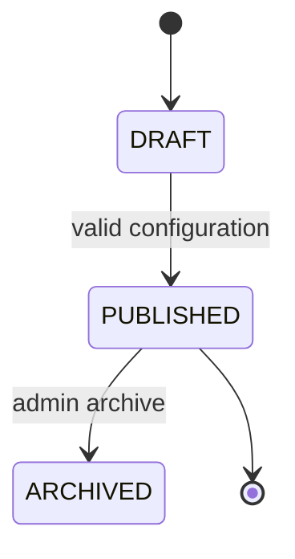
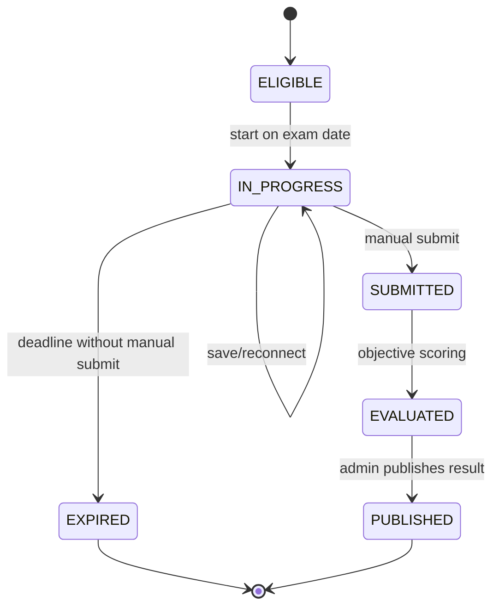

# Exam Workflows

## Exam lifecycle

An exam is published only when it has valid questions, duration, date, eligibility rule, and result publication policy. The passing cutoff is disabled by default (`EXAM_CUTOFF_ENABLED=false`). When enabling it, set `NEXT_PUBLIC_EXAM_CUTOFF_ENABLED=true` in the frontend as well so admins can choose a percentage or marks rule; a new exam defaults to 40% if no percentage is supplied.

## Candidate attempt lifecycle

## Start rules

- The backend clock is authoritative.
- Current time must fall within the exam date in `Asia/Kolkata`.
- Candidate must be authenticated and eligible.
- No prior attempt may exist for that candidate and exam.
- A second browser/device session for the same attempt is rejected or requires controlled takeover; release-one recommendation is rejection.
- The backend issues and persists one attempt-session token. Refreshes reuse it; a second session receives `409 ACTIVE_SESSION_EXISTS`.
- Camera permission and required pre-exam consent must be completed before attempt creation/start.

## Saving and recovery

Each answer save carries an idempotency key and attempt version. The backend rejects writes after finalization and rejects stale versions according to the chosen optimistic-concurrency policy. The frontend retries only safe, idempotent operations and shows the last server-confirmed save time.

## Submission

Manual submission requires a confirmation dialog. The backend transaction marks the attempt final, freezes answer changes, calculates objective score once, and records an audit event. Automatic submission has the same transaction semantics but no browser dialog.

## Monitoring

The frontend may detect hidden page, camera failure, no face, or multiple faces. Monitoring signals are warnings and are not proof of cheating. The backend records the event and warning count; warnings never automatically submit or fail the attempt. The candidate may continue and manually submit while the attempt is still within its deadline.

## Result publication

Objective evaluation can finish immediately after submission, but candidates see no result until the administrator-controlled publication condition is met. Candidate result response exposes only the final score while cutoff is disabled; qualification labels are not shown.
