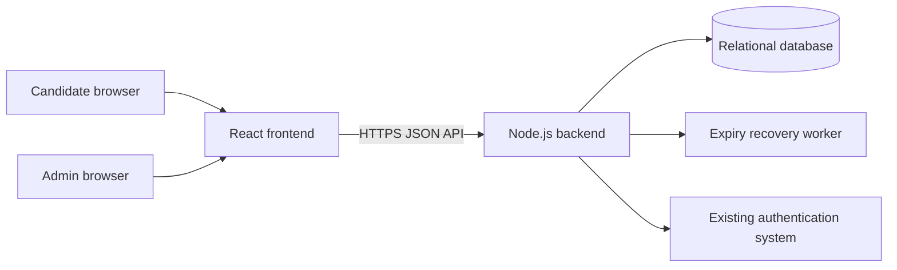

# System Architecture

## Target structure

```text
project-root/
├── frontend/          # React application
├── backend/           # Node.js API and trusted services
└── docs/              # Product and technical documentation
```

The repository baseline uses Node.js `node:sqlite` for zero-setup local persistence and keeps authentication behind an adapter. The production path uses PostgreSQL through the pooled adapter in `backend/src/postgres.js`; the database is selected with `DATABASE_DRIVER` and `DATABASE_URL`.

## Boundary



The frontend renders questions, collects answers, requests camera access, shows timers and states, and submits monitoring events. The backend owns identity mapping, eligibility, exam configuration, question delivery, answer persistence, deadlines, scoring, publication, authorization, and audit records.

## Request flow

1. Existing login authenticates the candidate.
2. Frontend calls the backend with the existing session/token.
3. Backend maps the authenticated identity to a candidate record.
4. Backend validates exam date, eligibility, attempt uniqueness, and camera-policy requirements.
5. Backend creates or returns one attempt with a server-calculated deadline.
6. Frontend receives public question data only.
7. Answer saves and monitoring events are validated against attempt state and deadline.
8. Backend finalizes manually or through expiry recovery.
9. Objective scoring runs once; result publication remains separately controlled.

## Time model

All exam business dates are interpreted in `Asia/Kolkata`. Persist instants in UTC where the database supports it, and persist the exam date plus timezone identifier for reproducibility. For a candidate starting at `startAt`, the attempt deadline is:

```text
min(startAt + configuredDuration, endOfExamDateInAsia/Kolkata)
```

This means starting late provides only the time remaining before the date ends.

## Deployment

Frontend and backend may be deployed independently. The backend must be the only component with database credentials, signing secrets, privileged service credentials, scheduler access, and answer keys. Configure an explicit frontend origin allowlist and secure cookie or token handling after the authentication mechanism is supplied.

## Recommended architectural style

Start with a modular Node.js backend rather than distributed services. Separate modules for exams, questions, attempts, answers, evaluation, results, monitoring, authentication adapter, and audit. The backend includes a SQLite local adapter, a pooled PostgreSQL production adapter, and periodic/on-request expiry recovery. Both adapters share the same API/domain behavior and ordered migration contract.
